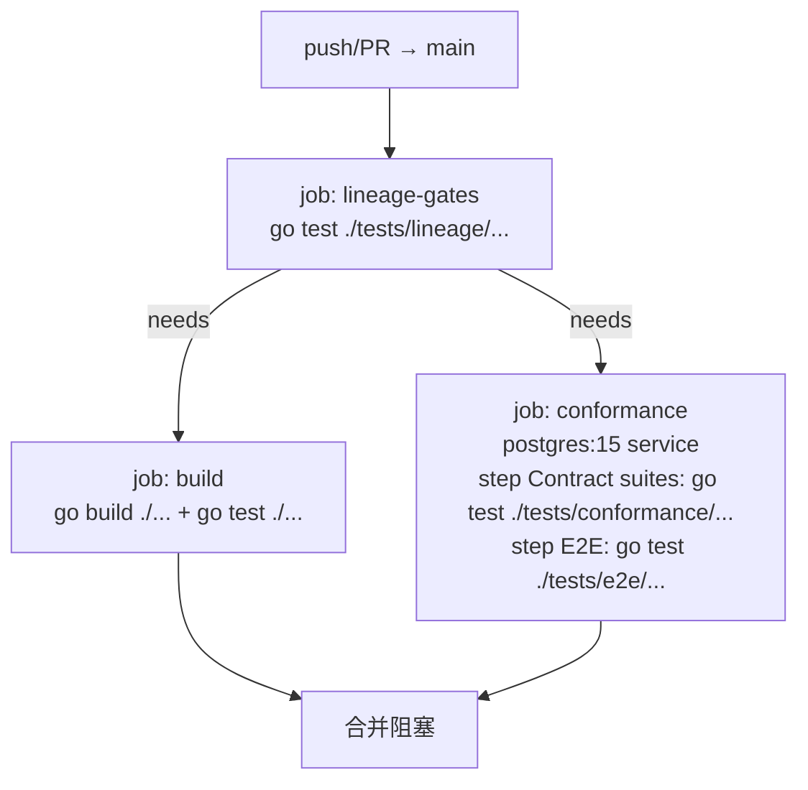

# wicket-pg 部署与 CI 指南

> 面向读者的任务：理解 CI 门禁顺序、如何发布新版本、合并/发布时注意什么。

## 一、CI 管线（`.github/workflows/ci.yml`）



| Job | 做什么 | 环境 |
|---|---|---|
| `lineage-gates` | 三项血缘门禁（版权头 / 零上游标注 / 中性提交信息） | Go `1.27.0` |
| `build` | `go build ./...` + `go test ./...`（无库测试自动 skip） | Go `1.27.0`，`needs: lineage-gates` |
| `conformance` | 两个步骤共用同一 PG：`Contract suites` 跑三组契约套件（grant 族 9 口 + session + keymgmt，6.0.0）；`E2E` 跑 `tests/e2e/` 真实库语义测试（直接列断言、000004 与 000007 回填等）。30 分钟超时 | `postgres:15` service 容器，`WICKET_PG_TEST_DATABASE_URL` 注入 |

设计要点：

- **血缘门禁先跑并 gate 住一切**：授权问题应在任何构建工作之前失败（`build` 与 `conformance` 都 `needs: lineage-gates`）。
- **契约套件与 e2e 用 service 容器**（`postgres:15`），不用 testcontainers；两者都在 `conformance` job 内跑，因此 `tests/e2e/` 下的库断言在 CI 中不会 skip。
- **CI 配置被静态断言**：`tests/e2e/ci_job_e2e_test.go` 用 yaml 解析 workflow 文件，校验 service 形态、环境变量注入、命令形态（`GOWORK=off`、无 `WithMay` 强制）等——**改 `ci.yml` 必须同步更新该测试**。
- **安全红线**：CI 不消费事件提供的文本，`run:` 块全是固定命令，禁止把 `${{ github.event.* }}` 插进 `run:` 块（命令注入路径）。

## 二、本地等价验证（CI 实跑前提）

合并前保证三件事全绿：

```bash
GOWORK=off go test ./tests/lineage/...        # = lineage-gates job
GOWORK=off go build ./... && GOWORK=off go test ./...   # = build job（无库环境）
WICKET_PG_TEST_DATABASE_URL=... GOWORK=off go test ./tests/conformance/...  # = conformance job：Contract suites 步骤
WICKET_PG_TEST_DATABASE_URL=... GOWORK=off go test ./tests/e2e/...          # = conformance job：E2E 步骤
```

无法本地跑契约套件与 e2e 时：push 后到 Actions 页确认三个 job 均绿再合并（sprint-status 中 epic-2 有对应 action item）。

## 三、发布流程

1. **功能与测试就绪**：全量回归绿（见上）；`git status` 干净；story 交付物齐全。
2. **版本号同步**：打 tag 前确认 `README.md` 引用版本、`go.mod` 依赖（wicket 侧）与实际一致，`CHANGELOG.md` 已写好该版本条目（英文，功能中性），且条目日期等于实际打 tag 的日期（不一致先改日期并提交）。
3. **CI 确认**（打 tag 前）：push 主干后 CI 三个 job（`lineage-gates` / `build` / `conformance`）均为 success，且该 run 的 head sha 等于要打 tag 的提交。未满足不得进入下一步。
4. **打 tag**（轻量 tag）：

```bash
git tag v0.5.0
git push origin v0.5.0
```

5. **取用验证**（tag push 后立即执行）：在仓外空目录，用默认 GOPROXY（`proxy.golang.org`）与 checksum 数据库、本地工具链和全新的模块缓存，按消费者方式 `go get` 新 tag 并编译一个引用 `store` 与 `migrations` 的 main 包。本机 `go env GOPROXY` 若为镜像（如 `goproxy.cn`），必须按下面显式覆盖；`GOPRIVATE` / `GONOPROXY` / `GONOSUMDB` 一并置空，否则验证会绕过 proxy 与 sumdb，测不到分发层问题。v0.1.0 的分发层分裂正是缺少这一步的结果。整段在子 shell 中执行，`cd` 与环境变量不会泄漏到当前 shell，任一步失败即停止：

```bash
(
  set -e
  V=v0.5.0; WICKET=v0.15.0
  D=$(mktemp -d); trap 'chmod -R u+w "$D" 2>/dev/null; rm -rf "$D"' EXIT
  mkdir -p "$D/mod" "$D/cache" && cd "$D/mod"
  export GOWORK=off GOTOOLCHAIN=local GOFLAGS= \
    GOPROXY=https://proxy.golang.org,direct GOSUMDB=sum.golang.org \
    GOPRIVATE= GONOPROXY= GONOSUMDB= GOMODCACHE="$D/cache"
  go mod init example.com/consume
  printf '%s\n' 'package main' '' 'import (' \
    '	_ "github.com/gonewx/wicket-pg/migrations"' \
    '	_ "github.com/gonewx/wicket-pg/store"' ')' '' 'func main() {}' > main.go
  go get "github.com/gonewx/wicket-pg@$V"
  go mod tidy
  go build ./...
  test "$(go list -m -f '{{.Version}}' github.com/gonewx/wicket-pg)" = "$V"
  test "$(go list -m -f '{{.Version}}' github.com/gonewx/wicket)" = "$WICKET"
  go clean -modcache   # 模块缓存文件只读，先清缓存，EXIT 时再 rm -rf "$D"
  echo "consume check OK: wicket-pg $V, wicket $WICKET"
)
```

   任一步失败：先上报，不重打、不移动、不删除 tag；修正只能通过发新补丁版本（如 v0.5.1）完成。

6. **创建 GitHub Release**（在仓库根目录执行）：发布说明从 `CHANGELOG.md` 截取该版本条目（`## [x.y.z]` 标题之后、下一个 `## ` 标题之前），与仓内同文；`--verify-tag` 保证 tag 不存在时失败而不是由 gh 自建 tag：

```bash
V=v0.5.0
awk -v h="## [${V#v}]" 'index($0,h)==1{f=1;next} f&&/^## /{exit} f' CHANGELOG.md > "/tmp/notes-$V.md"
test -s "/tmp/notes-$V.md"
NO_PROXY="*" HTTP_PROXY="" HTTPS_PROXY="" gh release create "$V" -R gonewx/wicket-pg --verify-tag --title "$V" --notes-file "/tmp/notes-$V.md"
```

7. **发版纪律**：
   - **Go 版本标记两处形态不同且各自精确**：`go.mod` 的 `go 1.27` 是对下游的语言版本承诺（不带补丁号），`ci.yml` 的 `1.27.0` 是本仓构建环境 pin（取精确补丁版）。rc 已于 Go 1.27.0 发布后去除，`tests/e2e/ci_job_e2e_test.go` 分别精确比对两者，预发布值一律不得通过。
   - 已发布 tag 不可变：v0.1.0 因分发层分裂（proxy/sumdb 固定去 rc 旧内容，与 GitHub tag 分裂）**不可用**，默认 GOPROXY 消费者拉到的 v0.1.0 不可编译；v0.1.1 与 v0.1.2 可用但仍携带 rc directive——文档在 v0.1.x 线内只引用 v0.1.3（首个不携带 rc directive 的版本，也是与 wicket v0.1.x 组合时应停留的版本）；面向 wicket v0.15.0 的安装与升级引用 v0.5.0（2026-11-27 已发布），宿主仍在 wicket v0.10.0 至 v0.12.0 时引用 v0.4.0（2026-11-22 已发布），仍在 wicket v0.8.0 时引用 v0.3.0（v0.3.0 新增 PAR 与 DCR store；v0.2.0 的升级说明建议升级前对各 store 调用 `RemoveExpired`，会删除 v0.1.x 签发的刷新令牌，已由 v0.2.1 更正，v0.3.0 沿用更正后的说明）。
   - 提交信息保持功能中性（门禁扫全量 git 历史）。

## 四、远端操作注意事项

- `gh` 命令必须排除代理（环境有全局代理，直连会失败）：

```bash
NO_PROXY="*" HTTP_PROXY="" HTTPS_PROXY="" gh <command>
```

- 历史遗留：在 v0.1.0 tag 窗口期 fetch 过的 clone 会永久残留陈旧 tag 引用（git fetch 拒绝移动已有轻量 tag），无法从本仓修复，仅需知晓。

## 五、部署形态（给宿主）

本仓是库不是服务，无 Dockerfile / K8s 清单——「部署」即宿主集成：

1. 宿主 `GOWORK=off go get github.com/gonewx/wicket-pg@v0.5.0`（要求 wicket v0.15.0；宿主仍在 wicket v0.10.0 至 v0.12.0 时停留在 v0.4.0，仍在 wicket v0.8.0 时停留在 v0.3.0，仍在 wicket v0.1.x 时停留在 v0.1.3）；
2. 启动序列中调用 `migrations.Up(ctx, pool)`（幂等）；
3. 构造九个 store 注入 wicket（开启 wicket 的 PAR 特性时再加 `PushedAuthorizationRequestStore`；开启动态客户端注册或依赖它的特性时再加 `ClientRegistrationStore`，经 `ServerConfig.SetClientRegistrationStore` 注入，它同时实现 `storage.ClientOriginLookup` 并服务全部客户端读取，与 `SetClientStore` / `SetClients` / `SetClientsProvider` 互斥；全开共十一个。这两个 store 自 v0.3.0 起提供，开启 DCR 前须先预置既有客户端，见下文「开启 DCR 前预置既有客户端」），装配期调用各 store 的 `ConformsTo()` 分别与对应套件的 `SuiteVersion` 常量比对（`storagetest` / `sessiontest` / `keymgmttest`，当前均为 6.0.0；不要硬编码字面量）。注意该比对在同一构建内恒成立，不能发现不兼容的适配器，返回值的可信度来自本仓的交付纪律（见 `docs/api-contracts.md` 第五节）。

已在跑 v0.4.x 的宿主升级到 v0.5.0：`GOWORK=off go get github.com/gonewx/wicket-pg@v0.5.0`，它会把宿主的 wicket 依赖抬到 v0.15.0（先读 wicket CHANGELOG 的 `[0.11.0]` 至 `[0.15.0]`；本仓没有面向 wicket v0.13.0 / v0.14.0 的发布）。步骤：

1. **先停掉所有 v0.4.x 写入方，再执行 `migrations.Up(ctx, pool)` 应用 000007**，应用完成后才让 v0.5.0 的 store 接流量。000007 给 `device_codes` 与 `backchannel_auth_requests` 加 `version` 列（存量行为 1），给 `sessions` 加 `renewed` 列并在同一事务内从 payload 回填（只重写 `sessions` 一张表，不建索引）。v0.4.x 与 v0.5.0 不能混跑：v0.4.x 的会话时间只读写 payload，v0.5.0 读列、续期只写列，混跑会丢失续期；v0.4.x 更新设备流与 CIBA 记录时不推进版本列，版本守卫随之失效。
2. **装配期比对 `ConformsTo()`**：变为 6.0.0；与套件常量比对的宿主无需改动，硬编码 `4.0.0` 的宿主须同步修改。
3. **直接调用设备流 / CIBA store 的宿主**（如自行写入 CIBA 批准）须带读到的 `Version` 调用 `UpdateByUserCode` / `UpdateBackchannelAuthenticationRequest`，遇到 `storage.ErrVersionConflict` 重读后重试；更新不存在的 user code 或 request id 现在返回 `storage.ErrNotFound`，不再是静默成功。
4. **回退**：000007 的 down 文件删除新增列，v0.5.0 写入的续期只在列中，会随之丢失；不要用 `migrations.Down`（它会拆除全部迁移与数据）。宿主须停留在 wicket v0.10.0 至 v0.12.0 时留在 v0.4.0。

已在跑 v0.3.x 的宿主：v0.3.x → v0.4.0 这一步没有新迁移、不需要回填（要求 wicket v0.10.0）；直接升级到 v0.5.0 时再按上一段应用 000007。`ConformsTo()` 在 v0.4.0 为 4.0.0（v0.5.0 起为 6.0.0）：与套件常量比对的宿主无需改动，硬编码 `3.0.0` 的宿主须同步修改。新增的 `RefreshTokenStore.RemoveOnlineRefreshTokensBySession` 由 wicket 在启用 `ServerConfig.SetRevokeOnlineRefreshTokensOnLogout(true)` 或高安全档时于登出回调中调用，删除该会话中 scope 不含精确元素 `offline_access` 的刷新令牌、保留离线令牌；scope 从各令牌的 payload 判定，无需迁移。只有带 session 存储的令牌会被选中：wicket 仅在该开关生效期间为在线刷新令牌记录 session，开关开启前签发的、以及 `session_id` 为 NULL 的令牌（如 wicket v0.1.x 签发的）都不会被选中；wicket 内置签发只在请求了 `offline_access` 时才创建刷新令牌，该开关针对的是宿主自有服务、扩展授权或迁移数据写入的在线令牌。宿主须停留在 wicket v0.8.0 时留在 v0.3.0：wicket v0.10.0 的刷新令牌端口多了该方法，v0.3.0 无法与之组合。

已在跑 v0.2.x 的宿主升级到 v0.5.0：`GOWORK=off go get github.com/gonewx/wicket-pg@v0.5.0`（抬到 wicket v0.15.0）之后调用 `migrations.Up(ctx, pool)`，应用 000005、000006 与 000007（000007 的注意事项见上文 v0.4.x 段）。两者各新建一张表（`pushed_authorization_requests`、`client_registrations`），不改既有表，不需要回填。开启 PAR 后宿主须定期调用 `PushedAuthorizationRequestStore.RemoveExpired`，wicket 不代为回收。已在跑 v0.1.x 的宿主按下文第六节升级。

### 开启 DCR 前预置既有客户端

经 `ServerConfig.SetClientRegistrationStore` 注入后，注册 store 是唯一的客户端来源：与 `SetClientStore` / `SetClients` / `SetClientsProvider` 并用时，wicket 在 `Freeze()` 时 panic；wicket 也没有静态客户端选项。因此切换前，要对每个既有的第一方 / 静态客户端调用一次 `RegisterClient`，把它写进 `client_registrations`。顺序是：先冻结旧客户端来源的变更，再预置，最后切换配置；滚动发布期间，新旧实例的客户端来源不同。

- **`Client` 原样传入。** store 用 `storage.EncodeClient` 编码，codec 不做哈希：`Secret.Value` 里必须已经是 secret 的哈希值，不能是明文，哈希形式与 `SetClients` 中相同（wicket 的 `utils.Sha256`，与 wicket 注册端点存储的形式一致）。
- **`RegistrationAccessTokenDigest` 有两种取法。**
  - 留空串 `""`：wicket 的客户端管理端点（RFC 7592）对该客户端一律拒绝。推荐第一方客户端这样做。
  - 由宿主自行生成注册访问令牌，摘要取 `clientregistration.RegistrationAccessTokenDigest(token)`，令牌由宿主自己保管。
- **`RegistrationTime` 取客户端原创建时间或预置时刻，不要用零值**：管理响应里的 `client_id_issued_at` 取自这个字段。
- **重复执行时返回 `storage.ErrDuplicateHandle`，视为「已预置」。** 它只表示该 id 已存在，重跑**不会**更新源端已改动的客户端。之后要修改，先 `FindClientRegistration` 读出，再带读到的修订号调用 `UpdateClientRegistration`。
- **遇到 `ErrDuplicateHandle` 以外的错误要停下**：全部客户端都预置成功或已存在之前，不要切换。
- **之后退回 `SetClients` / `SetClientStore` 时**，经 DCR 注册或修改的客户端不会带回。
- **墓碑化的 client id 不能再预置**：删除留下的墓碑永久占住该 id。

空摘要预置的行为（`FindClientById` 与 origin 查找可见、摘要列为空串而非 NULL、重复预置返回 `ErrDuplicateHandle` 且原行不变）由 `tests/e2e/client_registration_e2e_test.go` 锁住。

宿主注意（已知风险，deferred-work 留档）：

- **连接池生命周期**：本仓 store 不创建也不关闭 pool，也不实现 `io.Closer`——宿主必须自己 `pool.Close()`。
- **多实例并发迁移**：并发 `Up` 无 advisory lock，多实例同时启动可能 PK 冲突；建议单实例迁移或自行加锁。
- **表名冲突**：`schema_migrations` 与 golang-migrate 默认表同名；共用库宿主注意。
- **清理入口**：宿主自行按需调用各 store 的 `RemoveExpired(ctx, cutoff)`（显式一次性回收，返回计数），适配器不起后台任务。从 v0.1.x 升级的宿主，在完成 6.4 的刷新令牌回填之前，不要对刷新令牌调用 `RemoveExpired`。开启 PAR 的宿主应定期调用 `PushedAuthorizationRequestStore.RemoveExpired(ctx, cutoff)`，cutoff 取当前时间即可（`RetentionExpiration` 已含交互往返宽限）：PAR 记录写入频繁，wicket 不会替宿主回收。`ClientRegistrationStore` 没有回收方法：注册客户端没有服务端生命周期，删除只留墓碑行（不含 secret 哈希与注册访问令牌摘要），墓碑永久占住 client id。
- **`migrations.Down` 是全量拆除**：它对所有已应用迁移逆序执行 down 文件，包括 `000001`（DROP 全部表），会删除所有表和数据。它不是回退单个迁移的手段，生产库不要调用。

## 六、从 v0.1.x 升级到 v0.2.x / v0.3.0 / v0.4.0 / v0.5.0

本节按 v0.5.0 描述（v0.5.0 要求 wicket v0.15.0，v0.4.0 要求 wicket v0.10.0，v0.2.x / v0.3.0 要求 wicket v0.8.0；000004 相关步骤对各版本相同；升级到 v0.5.0 时同一次 `Up` 还会应用 000007，见第五节 v0.4.x 段），v0.2.0 / v0.2.1 / v0.3.0 / v0.4.0 同样适用。v0.2.0 依赖 wicket v0.8.0，并带来迁移 `000004_scoped_removal_columns`：为 `authorization_codes` / `refresh_tokens` / `reference_tokens` 增加 `client_id`、`session_id` 定位列，为 `device_codes` 增加 `session_id` 定位列，为这 7 列与 `user_consents.client_id` 各建一个索引（共 8 个），并在同一事务内从 payload 回填存量行。8 个按 client / session 移除方法依赖这些列。

> v0.2.0 的升级说明建议升级前先用各 store 的 `RemoveExpired` 回收过期记录。这条建议对刷新令牌不成立：照做会删除 v0.1.x 签发的全部刷新令牌，包括仍然有效的（原因见 6.4）。v0.2.1 已更正，以本节为准。

> 与 wicket v0.1.x 组合时请留在 wicket-pg v0.1.3：v0.2.x / v0.3.0 要求 wicket v0.8.0，v0.4.0 要求 wicket v0.10.0，v0.5.0 要求 wicket v0.15.0，引入任一版本都会把宿主的 wicket 依赖抬到对应版本。

### 6.1 升级步骤

1. **停掉所有旧版本写入方**。`Up` 跑完后，旧二进制的 INSERT 会让定位列为 NULL，旧二进制的 `UpdateRefreshToken` / `UpdateByUserCode` 会留下陈旧值；回填只在迁移事务内执行一次，事后不会补齐，按 client / session 移除会漏删这些行。先停旧写入方是必要条件，也已足够；本仓不提供补偿回填。
2. **执行 NUL 预检**（见 6.2），有命中先处理。
3. **在维护窗口内执行 `migrations.Up(ctx, pool)` 应用 000004**。000004 在单个事务内对四张表（`authorization_codes` / `refresh_tokens` / `reference_tokens` / `device_codes`）做全表 UPDATE 再建 8 个索引，期间持有锁。大表可以先对授权码、引用（访问）令牌、设备码三个 store 调用 `RemoveExpired(ctx, cutoff)` 回收过期记录，缩短锁持有时间：wicket v0.1.x 签发这三类记录时都带 `CreationTime` / `Lifetime`。user consent、persisted grant、CIBA 请求、session 等 store 在记录没有过期时间时 `expires_at`（session 为 `expires`）存 NULL，`RemoveExpired` 不删除这类记录，也不受影响。**回填完成前不要对刷新令牌调用 `RemoveExpired`**，见 6.4。同一次 `Up` 还会应用 000005 / 000006（各建一张新表，无需回填）。
4. **停用宿主对 `RefreshTokenStore.RemoveExpired` 的自动调用**（启动序列、cron、定时器等），等 6.4 的确认查询返回 0 行后再恢复；然后**启动 v0.5.0 写入方**，装配期把所注入的全部 store 的 `ConformsTo()` 分别与对应套件的 `SuiteVersion` 常量比对（当前均为 6.0.0；不要硬编码字面量；该比对的含义见第五节第 3 步）。
5. **回填 v0.1.x 签发的刷新令牌**（见 6.4），完成后才可以对刷新令牌调用 `RemoveExpired`。回填用的是 v0.2.x 的公开端口，须在 000004 应用之后、首次回收刷新令牌之前执行。

### 6.2 NUL 预检

模型 JSON 中若含转义 `\u0000`（任意字符串字段里的 NUL 字符），回填时 `::jsonb` 转换会报 `unsupported Unicode escape sequence`，整个 000004 事务回滚，schema 保持 000003 形态。升级前逐表执行下列查询（000003 形态即可执行，不依赖新列）：

```sql
SELECT handle FROM authorization_codes WHERE position('\u0000' in convert_from(decode(payload->>'payload','base64'),'UTF8')) > 0;
SELECT handle FROM refresh_tokens      WHERE position('\u0000' in convert_from(decode(payload->>'payload','base64'),'UTF8')) > 0;
SELECT handle FROM reference_tokens    WHERE position('\u0000' in convert_from(decode(payload->>'payload','base64'),'UTF8')) > 0;
SELECT handle FROM device_codes        WHERE position('\u0000' in convert_from(decode(payload->>'payload','base64'),'UTF8')) > 0;
```

- 不用 `LIKE`：反斜杠是 `LIKE` 的转义符，`LIKE '%\u0000%'` 匹配的不是字面量 `\u0000`。
- 这是保守预检：字面量 `\\u0000`（JSON 中转义的反斜杠后跟 `u0000`）也会被报出来，人工核对后可放行。
- 有命中时：按 handle 删除这些记录，然后再执行 `Up`。授权码、引用令牌、设备码也可以等它们过期后用 `RemoveExpired` 回收；刷新令牌不能这样做，未回填的旧刷新令牌一调用 `RemoveExpired` 就会全部被删（见 6.4），命中的刷新令牌只能按 handle 删除。若未做预检而 `Up` 已失败，处理方式相同，事务已整体回滚，可直接重试。

### 6.3 回退

- **只回退二进制**（换回 v0.1.3）时，宿主还须把 wicket 依赖退回 v0.1.x 并重新构建（v0.1.3 不能与 wicket v0.8.0 或更高版本组合）。schema 留在 000004：旧二进制不认识定位列，它新写入的行定位列为 NULL，它更新过的行定位列为陈旧值。再次升级到 v0.2.x 或更高版本时，`Up` 看到 000004 已记账，**不会重新回填**，需要按下面的手工流程重做 000004。
- **手工重做 000004**（需先停掉所有写入方，并先执行 6.2 的 NUL 预检、处理命中：回退期间旧二进制写入的 payload 同样可能含 `\u0000`，否则下面的事务提交后 `Up` 会整体回滚，schema 停在 000003 形态）。down 文件随模块发布，没有源码树时可在模块缓存中找到：`$(go env GOMODCACHE)/github.com/gonewx/wicket-pg@v0.4.0/migrations/000004_scoped_removal_columns.down.sql`。手工执行时 down 文件本身不带事务，须与撤销记账放进同一个事务，避免「列已删除、000004 仍记账」的半完成状态：

  ```sql
  BEGIN;
  -- 1. 粘贴 000004_scoped_removal_columns.down.sql 的全部语句
  --    （删除 8 个定位列索引与 7 个定位列，payload 不动）
  -- 2. 撤销 000004 的记账
  DELETE FROM schema_migrations WHERE version = '000004';
  COMMIT;
  ```

  然后调用 `migrations.Up(ctx, pool)`：000004 重新执行并从 payload 重新回填全部行。上述事务需在 `Up` 所用连接的同一 search_path 下执行。
- **禁止用 `migrations.Down` 回退**：它会逆序回滚全部已应用迁移（含 `000001`），删除所有表和数据，不能用来单独撤销 000004。

### 6.4 v0.1.x 刷新令牌回填

**为什么要回填**：wicket v0.1.x 签发刷新令牌时不设置 `CreationTime` 和 `Lifetime`，两者都是零值。本仓在写入和更新时按 `CreationTime + Lifetime` 推导 `expires_at`，这类令牌因此得到 `0001-01-01`。`RefreshTokenStore.RemoveExpired(ctx, cutoff)` 删除 `expires_at < cutoff` 的记录，所以升级后第一次调用就会删除全部未回填的旧刷新令牌，包括仍然有效的，持有者只能重新授权。wicket v0.8.0 核心会在某个旧令牌首次兑换成功时补记这两个字段，但从未被兑换过的令牌一直保持零值。授权码、引用（访问）令牌和设备码不受影响：wicket v0.1.x 签发它们时都带 `CreationTime` / `Lifetime`。

**已按 v0.2.0 建议执行过 `RemoveExpired` 的宿主**：被删的刷新令牌无法从库内恢复，只能从备份恢复，或让持有者重新授权。留在 wicket v0.1.x + wicket-pg v0.1.3 的宿主同样不要调用 `RefreshTokenStore.RemoveExpired`，原因相同。

**何时做**：000004 已应用、v0.2.x 写入方已启动之后，第一次对刷新令牌调用 `RemoveExpired` 之前。启动写入方之前须先停用宿主对 `RefreshTokenStore.RemoveExpired` 的自动调用（见 6.1 第 4 步）。按 6.3 回退过二进制的宿主，回退期间 v0.1.x 又会签发零值令牌，再次升级后须重新执行本节。

**筛出旧记录**：

```sql
SELECT handle FROM refresh_tokens WHERE expires_at < '0002-01-01';
```

`expires_at` 落在公元 1 年，对应零值 `CreationTime` 加零值 `Lifetime`。v0.2.x 写入方签发的令牌带真实寿命，不会被选中。

**逐条回填**：只用公开端口。读出记录，设置 `CreationTime` 与 `Lifetime`，再以读到的 `Version` 调 `UpdateRefreshToken`；更新时 `expires_at` 按新值重算。不要用 SQL 直接改 `expires_at` 或 payload：只改 `expires_at` 会让它与 payload 中的零值不一致，核心按 payload 判过期。

```go
// handles 为上面查询的结果；lifetimeFor 由宿主按 client 配置实现（见下文）。
const maxAttempts = 5
for _, handle := range handles {
	for attempt := 1; ; attempt++ {
		if err := ctx.Err(); err != nil {
			return err
		}
		if attempt > maxAttempts {
			return fmt.Errorf("backfill %s: version conflict after %d attempts", handle, maxAttempts)
		}
		tok, err := refreshTokens.GetRefreshToken(ctx, handle)
		if errors.Is(err, storage.ErrNotFound) {
			break // 已被兑换替换或移除
		}
		if err != nil {
			return err
		}
		if !tok.CreationTime.IsZero() {
			break // 核心已在兑换时补记
		}
		tok.CreationTime = backfillTime // 回填时刻，或已知的签发时刻
		tok.Lifetime = lifetimeFor(tok.ClientId)
		err = refreshTokens.UpdateRefreshToken(ctx, handle, tok, tok.Version)
		if errors.Is(err, storage.ErrVersionConflict) {
			continue // 有并发写入，重读后重试
		}
		if err != nil && !errors.Is(err, storage.ErrNotFound) {
			return err
		}
		break
	}
}
```

**`Lifetime` 取值**：按该记录所属 client 的刷新令牌寿命配置计算，与签发时的算式一致。取值表见 wicket 存储持久化指南「既有 refresh token 记录的迁移」一节（<https://github.com/gonewx/wicket/blob/v0.8.0/docs/storage-persistence-guide.md>），本仓不复制该表。适配器不提供回填 helper，因为它拿不到各 client 的寿命配置。不限寿命的 client 须写 `2147483647`（`Lifetime` 的最大值），不要写 0：`Lifetime` 为 0 时 `expires_at` 等于回填时刻，下一次回收就会删掉该令牌，确认查询也查不出它。

**`CreationTime` 取值与安全后果**：以回填时刻作 `CreationTime`，会让旧令牌（包括按原签发时刻早该过期的）重新获得完整寿命。能取得签发时刻时优先用签发时刻。不愿延长旧令牌寿命的宿主，可以不回填，改为按 client 撤销（`RemoveRefreshTokensByClient`），让持有者重新授权。

**确认**：回填完成后再执行一次筛选查询，应返回 0 行；仍有结果时对这些 handle 重复上面的循环。之后才可以按第五节的清理入口对刷新令牌调用 `RemoveExpired`。

**session 维度**：wicket v0.1.x 从不设置刷新令牌的 `SessionId`，000004 回填后这些令牌的 `session_id` 为 NULL，`RemoveRefreshTokensBySession` 与 `RemoveOnlineRefreshTokensBySession` 都删不到它们（登出时撤销在线刷新令牌也不覆盖它们）；按 client 移除不受影响。本节的回填不改变这一点，`SessionId` 无从补记。
