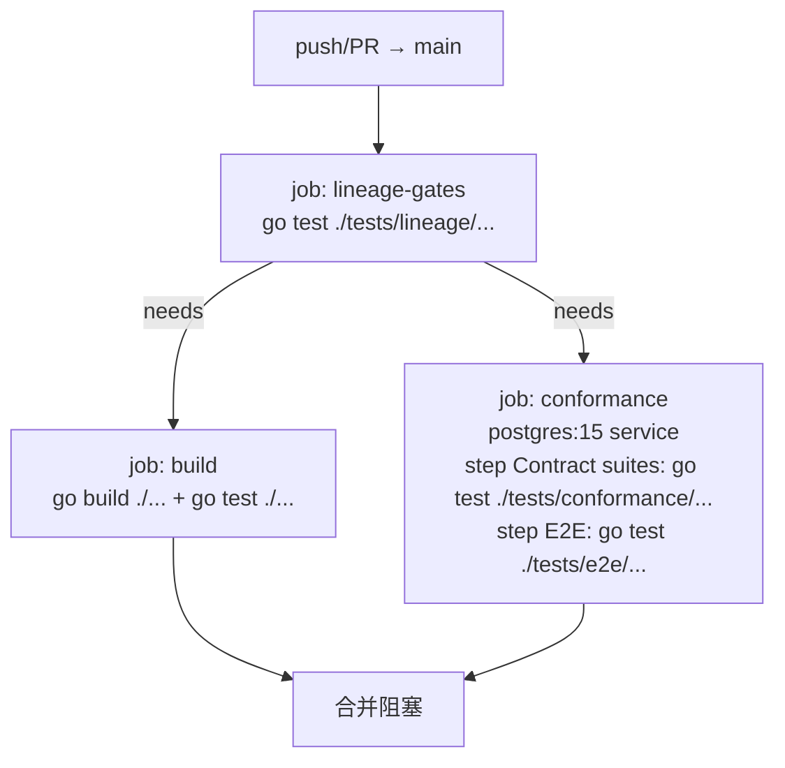

# wicket-pg 部署与 CI 指南

> 面向读者的任务：理解 CI 门禁顺序、如何发布新版本、合并/发布时注意什么。

## 一、CI 管线（`.github/workflows/ci.yml`）



| Job | 做什么 | 环境 |
|---|---|---|
| `lineage-gates` | 三项血缘门禁（版权头 / 零上游标注 / 中性提交信息） | Go `1.27.0` |
| `build` | `go build ./...` + `go test ./...`（无库测试自动 skip） | Go `1.27.0`，`needs: lineage-gates` |
| `conformance` | 两个步骤共用同一 PG：`Contract suites` 跑三组契约套件（grant 族 7 口 + session + keymgmt，3.0.0）；`E2E` 跑 `tests/e2e/` 真实库语义测试（直接列断言、000004 回填等）。30 分钟超时 | `postgres:15` service 容器，`WICKET_PG_TEST_DATABASE_URL` 注入 |

设计要点：

- **血缘门禁先跑并 gate 住一切**：授权问题应在任何构建工作之前失败（`build` 与 `conformance` 都 `needs: lineage-gates`）。
- **契约套件与 e2e 用 service 容器**（`postgres:15`），不用 testcontainers；两者都在 `conformance` job 内跑，因此 `tests/e2e/` 下的库断言在 CI 中不会 skip。
- **CI 配置被静态断言**：`tests/e2e/ci_job_e2e_test.go` 用 yaml 解析 workflow 文件，校验 service 形态、环境变量注入、命令形态（`GOWORK=off`、无 `WithMay` 强制）等——**改 `ci.yml` 必须同步更新该测试**。
- **安全红线**：CI 不消费事件提供的文本，`run:` 块全是固定命令，禁止把 `${{ github.event.* }}` 插进 `run:` 块（命令注入路径）。

## 二、本地等价验证（CI 实跑前提）

合并前保证三件事全绿：

```bash
GOWORK=off go test ./tests/lineage/...        # = lineage-gates job
GOWORK=off go build ./... && GOWORK=off go test ./...   # = build job（无库环境）
WICKET_PG_TEST_DATABASE_URL=... GOWORK=off go test ./tests/conformance/...  # = conformance job：Contract suites 步骤
WICKET_PG_TEST_DATABASE_URL=... GOWORK=off go test ./tests/e2e/...          # = conformance job：E2E 步骤
```

无法本地跑契约套件与 e2e 时：push 后到 Actions 页确认三个 job 均绿再合并（sprint-status 中 epic-2 有对应 action item）。

## 三、发布流程

1. **功能与测试就绪**：全量回归绿（见上）；`git status` 干净；story 交付物齐全。
2. **版本号同步**：打 tag 前确认 `README.md` 引用版本、`go.mod` 依赖（wicket 侧）与实际一致。
3. **打 tag**（轻量 tag）：

```bash
git tag v0.2.0
git push origin v0.2.0
```

4. **发版纪律**：
   - **Go 版本标记两处形态不同且各自精确**：`go.mod` 的 `go 1.27` 是对下游的语言版本承诺（不带补丁号），`ci.yml` 的 `1.27.0` 是本仓构建环境 pin（取精确补丁版）。rc 已于 Go 1.27.0 发布后去除，`tests/e2e/ci_job_e2e_test.go` 分别精确比对两者，预发布值一律不得通过。
   - 已发布 tag 不可变：v0.1.0 因分发层分裂（proxy/sumdb 固定去 rc 旧内容，与 GitHub tag 分裂）**不可用**，默认 GOPROXY 消费者拉到的 v0.1.0 不可编译；v0.1.1 与 v0.1.2 可用但仍携带 rc directive——文档在 v0.1.x 线内只引用 v0.1.3（首个不携带 rc directive 的版本，也是与 wicket v0.1.x 组合时应停留的版本）；面向 wicket v0.8.0 的安装与升级引用 v0.2.0。
   - 提交信息保持功能中性（门禁扫全量 git 历史）。

## 四、远端操作注意事项

- `gh` 命令必须排除代理（环境有全局代理，直连会失败）：

```bash
NO_PROXY="*" HTTP_PROXY="" HTTPS_PROXY="" gh <command>
```

- 历史遗留：在 v0.1.0 tag 窗口期 fetch 过的 clone 会永久残留陈旧 tag 引用（git fetch 拒绝移动已有轻量 tag），无法从本仓修复，仅需知晓。

## 五、部署形态（给宿主）

本仓是库不是服务，无 Dockerfile / K8s 清单——「部署」即宿主集成：

1. 宿主 `GOWORK=off go get github.com/gonewx/wicket-pg@v0.2.0`（要求 wicket v0.8.0；宿主仍在 wicket v0.1.x 时停留在 v0.1.3）；
2. 启动序列中调用 `migrations.Up(ctx, pool)`（幂等）；
3. 构造九个 store 注入 wicket，装配期调用各 store 的 `ConformsTo()` 分别与对应套件的 `SuiteVersion` 常量比对（`storagetest` / `sessiontest` / `keymgmttest`，当前均为 3.0.0；不要硬编码字面量）。注意该比对在同一构建内恒成立，不能发现不兼容的适配器，返回值的可信度来自本仓的交付纪律（见 `docs/api-contracts.md` 第五节）。

已在跑 v0.1.x 的宿主按下文第六节升级。

宿主注意（已知风险，deferred-work 留档）：

- **连接池生命周期**：本仓 store 不创建也不关闭 pool，也不实现 `io.Closer`——宿主必须自己 `pool.Close()`。
- **多实例并发迁移**：并发 `Up` 无 advisory lock，多实例同时启动可能 PK 冲突；建议单实例迁移或自行加锁。
- **表名冲突**：`schema_migrations` 与 golang-migrate 默认表同名；共用库宿主注意。
- **清理入口**：宿主自行按需调用各 store 的 `RemoveExpired(ctx, cutoff)`（显式一次性回收，返回计数），适配器不起后台任务。
- **`migrations.Down` 是全量拆除**：它对所有已应用迁移逆序执行 down 文件，包括 `000001`（DROP 全部表），会删除所有表和数据。它不是回退单个迁移的手段，生产库不要调用。

## 六、从 v0.1.x 升级到 v0.2.0

v0.2.0 依赖 wicket v0.8.0，并带来迁移 `000004_scoped_removal_columns`：为 `authorization_codes` / `refresh_tokens` / `reference_tokens` 增加 `client_id`、`session_id` 定位列，为 `device_codes` 增加 `session_id` 定位列，为这 7 列与 `user_consents.client_id` 各建一个索引（共 8 个），并在同一事务内从 payload 回填存量行。8 个按 client / session 移除方法依赖这些列。

> 与 wicket v0.1.x 组合时请留在 wicket-pg v0.1.3：v0.2.0 要求 wicket v0.8.0，引入它会把宿主的 wicket 依赖抬到 v0.8.0。

### 6.1 升级步骤

1. **停掉所有旧版本写入方**。`Up` 跑完后，旧二进制的 INSERT 会让定位列为 NULL，旧二进制的 `UpdateRefreshToken` / `UpdateByUserCode` 会留下陈旧值；回填只在迁移事务内执行一次，事后不会补齐，按 client / session 移除会漏删这些行。先停旧写入方是必要条件，也已足够；本仓不提供补偿回填。
2. **执行 NUL 预检**（见 6.2），有命中先处理。
3. **在维护窗口内执行 `migrations.Up(ctx, pool)` 应用 000004**。000004 在单个事务内对四张表（`authorization_codes` / `refresh_tokens` / `reference_tokens` / `device_codes`）做全表 UPDATE 再建 8 个索引，期间持有锁。大表宜先用各 store 的 `RemoveExpired(ctx, cutoff)` 回收过期记录，缩短锁持有时间。
4. **启动 v0.2.0 写入方**，装配期把九个 store 的 `ConformsTo()` 分别与对应套件的 `SuiteVersion` 常量比对（当前均为 3.0.0；不要硬编码字面量；该比对的含义见第五节第 3 步）。

### 6.2 NUL 预检

模型 JSON 中若含转义 `\u0000`（任意字符串字段里的 NUL 字符），回填时 `::jsonb` 转换会报 `unsupported Unicode escape sequence`，整个 000004 事务回滚，schema 保持 000003 形态。升级前逐表执行下列查询（000003 形态即可执行，不依赖新列）：

```sql
SELECT handle FROM authorization_codes WHERE position('\u0000' in convert_from(decode(payload->>'payload','base64'),'UTF8')) > 0;
SELECT handle FROM refresh_tokens      WHERE position('\u0000' in convert_from(decode(payload->>'payload','base64'),'UTF8')) > 0;
SELECT handle FROM reference_tokens    WHERE position('\u0000' in convert_from(decode(payload->>'payload','base64'),'UTF8')) > 0;
SELECT handle FROM device_codes        WHERE position('\u0000' in convert_from(decode(payload->>'payload','base64'),'UTF8')) > 0;
```

- 不用 `LIKE`：反斜杠是 `LIKE` 的转义符，`LIKE '%\u0000%'` 匹配的不是字面量 `\u0000`。
- 这是保守预检：字面量 `\\u0000`（JSON 中转义的反斜杠后跟 `u0000`）也会被报出来，人工核对后可放行。
- 有命中时：按 handle 删除这些记录，或等它们过期后用 `RemoveExpired` 回收，然后再执行 `Up`。若未做预检而 `Up` 已失败，处理方式相同，事务已整体回滚，可直接重试。

### 6.3 回退

- **只回退二进制**（换回 v0.1.3）时，宿主还须把 wicket 依赖退回 v0.1.x 并重新构建（v0.1.3 不能与 wicket v0.8.0 组合）。schema 留在 000004：旧二进制不认识定位列，它新写入的行定位列为 NULL，它更新过的行定位列为陈旧值。再次升级到 v0.2.0 时，`Up` 看到 000004 已记账，**不会重新回填**，需要按下面的手工流程重做 000004。
- **手工重做 000004**（需先停掉所有写入方，并先执行 6.2 的 NUL 预检、处理命中：回退期间旧二进制写入的 payload 同样可能含 `\u0000`，否则下面的事务提交后 `Up` 会整体回滚，schema 停在 000003 形态）。down 文件随模块发布，没有源码树时可在模块缓存中找到：`$(go env GOMODCACHE)/github.com/gonewx/wicket-pg@v0.2.0/migrations/000004_scoped_removal_columns.down.sql`。手工执行时 down 文件本身不带事务，须与撤销记账放进同一个事务，避免「列已删除、000004 仍记账」的半完成状态：

  ```sql
  BEGIN;
  -- 1. 粘贴 000004_scoped_removal_columns.down.sql 的全部语句
  --    （删除 8 个定位列索引与 7 个定位列，payload 不动）
  -- 2. 撤销 000004 的记账
  DELETE FROM schema_migrations WHERE version = '000004';
  COMMIT;
  ```

  然后调用 `migrations.Up(ctx, pool)`：000004 重新执行并从 payload 重新回填全部行。上述事务需在 `Up` 所用连接的同一 search_path 下执行。
- **禁止用 `migrations.Down` 回退**：它会逆序回滚全部已应用迁移（含 `000001`），删除所有表和数据，不能用来单独撤销 000004。
